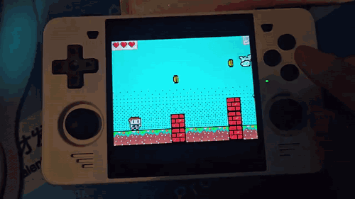
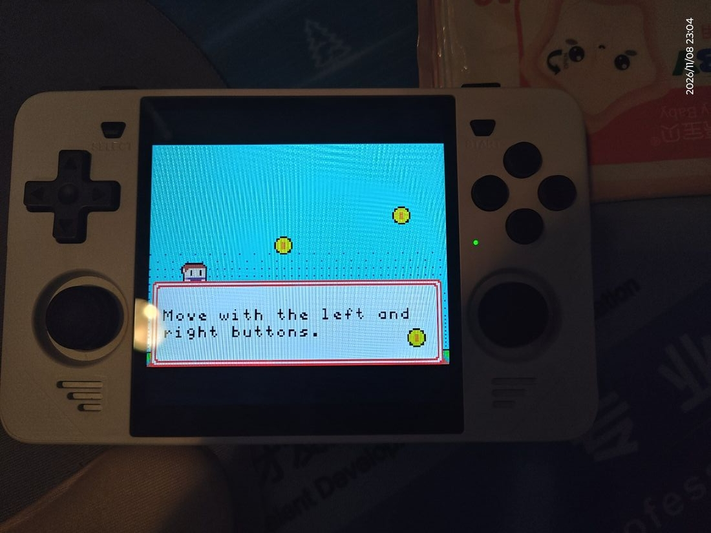
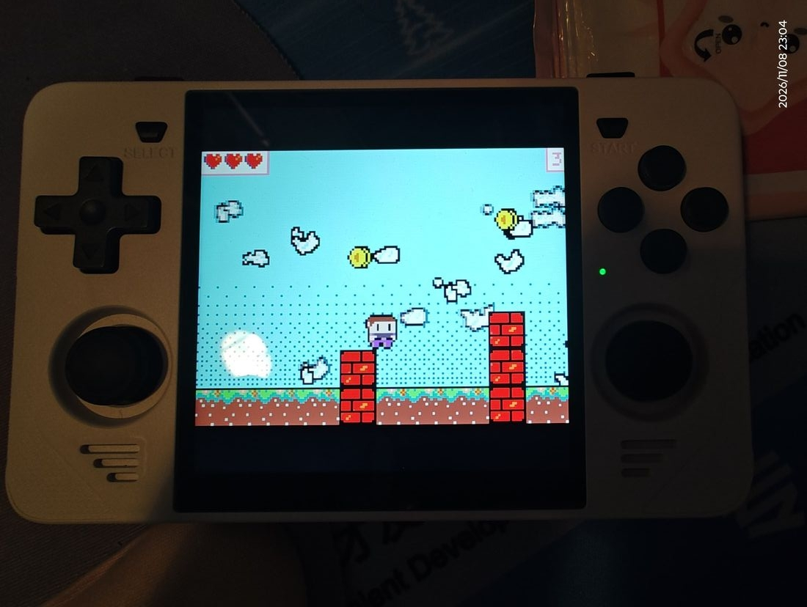

# MakeCode Arcade libretro Core（路线 B）

[English](README_EN.md) | 简体中文

[](https://github.com/whmzsu/makecode-arcade-libretro/actions/workflows/build.yml)

把 MakeCode Arcade 游戏作为"卡带"在 RetroArch 中运行，主线技术路线为
**pxt VM 字节码 + C++ 运行时**（路线 B），目标平台包括 PC 与低端 ARM 掌机
（RK3326 / RK3566 等）。

## 实机演示



*《Jumpy Platformer》跑在 Powkiddy RGB30（RK3566）· ArkOS + RetroArch，
卡带是官方 IDE 直接导出的 `.pxt64`。*

| 跳跃 | 吃金币 |
|---|---|
|  |  |

## 与既有两个 core 的关系

本项目相关姊妹仓库（同为 whmzsu 所有，均已在生产使用）：

| 仓库 | 引擎 | 定位 | 实测性能 |
|---|---|---|---|
| [mcarcade-core](https://github.com/whmzsu/mcarcade-core) | QuickJS 解释执行官方 sim | 兼容基准（语义=浏览器） | 桌面 ping 5ms/帧、cube-land 10ms/帧；RK3566 约 3~4 倍慢，重游戏掉帧 |
| [mcarcade-libretro](https://github.com/whmzsu/mcarcade-libretro) | Hermes AOT 字节码 + JIT | 性能升级尝试 | 桌面与 QuickJS 相近；aarch64 JIT 收益待真机验证 |
| 本项目 | **pxt VM 字节码 + 原生 C++ 引擎**（无 JS 引擎） | 低端掌机专用，路线 B | ✅ RK3566 真机流畅无卡顿；目标 60fps 单核 <15%，常驻 <16MB |

三个 core 共享同一套 C 基础设施（cart.c 卡带解析 / decompress.c LZMA /
cache.c 编译缓存 / 内嵌 pxtc 编译器）。路线 B 的价值在于**彻底去掉
JS 引擎层**——JS 模拟层（DOM mock、promise 微任务、GC、JS 逐帧逻辑）
正是弱机上 step 耗时的根源。

## 目录结构

```
makecode_arcade/
├── README.md               本文件
├── LICENSE                 MIT
├── .github/workflows/build.yml  GitHub Actions：全平台编译回归 + 测试产物
├── .gitlab-ci.yml          libretro 官方 buildbot 收录用（镜像仓库时生效）
├── docs/
│   ├── ROUTE-B-DESIGN.md   路线 B 总体设计（架构 / 数据流 / 里程碑 / 风险）
│   ├── PNG-FORMAT.md       .png 卡带（隐写打包）格式规格
│   ├── M2-RUNTIME-NOTES.md pxt 运行时考古笔记（官方宿主 8 函数 ABI）
│   ├── M3-VM-HOST.md       VM 宿主接入、验收记录与已知限制
│   ├── CROSS-COMPILE.md    交叉编译（目标矩阵 / 用法 / 踩坑）
│   ├── DEVICE-TEST.md      真机验收记录（RK3566 + ArkOS，含故障复盘）
│   └── INPUT.md            按键与选项（映射、描述符、验证方法）
├── core/                   libretro core（C/C++）
│   ├── libretro.h          官方头文件（来自 libretro-common，MIT）
│   ├── Makefile            标准 libretro 构建（platform=unix/win/win64/osx/android）
│   ├── jni/                Android.mk + Application.mk（官方 CI 的 ndk-build 路径）
│   ├── src/
│   │   ├── libretro_core.cpp   libretro 入口 + 帧循环 + 视频/音频/输入接线
│   │   ├── vm_host.cpp         pxt VM 宿主封装（镜像装载/按键沿/拉帧拉音频）
│   │   └── platform.h          pxt VM 宿主 ABI（对齐官方 sdlmain.cpp）
│   ├── tests/              假前端 core_test / 契约自检 contract_test / VM 冒烟 vm_smoke
├── runtime/
│   ├── pxtapp/             pxt 官方 VM 内核+引擎原语（vendored，已打 3 个补丁，游戏无关）
│   └── VENDORING.md
├── tools/
│   ├── build_core.sh       一键构建：DLL + 三个测试程序（core_test / contract_test / vm_smoke）
│   ├── make_local.sh       用 zig 驱动 core/Makefile（本地无目标工具链时）
│   ├── build_target.sh     单目标交叉编译（zig；Android 走 NDK clang）
│   ├── build_matrix.sh     发版矩阵（7 主流目标）/ --all 全架构
│   ├── package_release.sh  打包发行 zip（core + .info + 说明）
│   ├── inspect_binary.py   产物自检（架构/libc 基线/依赖/retro_* 导出，纯标准库）
│   ├── make_probe_cartridge.py  探针卡带生成器（按键/生命周期回归用，调并列仓库的 pxt 工具链）
│   ├── test_buttons.py     按键映射回归（16 用例）
│   ├── test_lifecycle.py   生命周期回归（换游戏/卸载/重置后音频）
│   ├── libretro_host.py    假前端宿主 + 描述符静态自检（--dry）
│   ├── extract_png_meta.py 独立 PNG 卡带解码验证工具（纯 Python 标准库）
│   └── make_test_cartridge.py  合成测试卡带生成器（编解码回环自测）
├── png_examples/           真实卡带样本（ping / jumpy / cube-land / falling-duck / destroy-the-castle）
└── test_cartridge.png      合成卡带样本（自测通过）
```

## 里程碑速览

| 里程碑 | 内容 | 状态 |
|---|---|---|
| M0 | core 骨架可编译、可被 RetroArch 加载、显示测试画面 | ✅ 编译验证通过（zig 0.17.0） |
| M1 | PNG 卡带解码（像素解码 + blob 位流 + LZMA + 项目 JSON） | ✅ 曾用 cart.c 接入，3 张真实卡带冒烟通过。**v0.3.5 起 core 侧整条链路已移除**（只认 `.pxt64`），PNG 解析只在工具链（cartconv / `tools/extract_png_meta.py`）里保留 |
| M2 | vendor pxt C++ 运行时（screen/sprite/引擎）独立构建 | ✅ pxtapp vendored 到 runtime/pxtapp（33 TU 游戏无关，已验证 ping/jumpy/cube-land 共用同一二进制） |
| M3 | pxt VM 字节码解释器接入，跑通第一个游戏 | ✅ **三款游戏全通**：vm_smoke（官方 ABI 直调）+ libretro 假前端路径（RGB565/按键沿/音频） |
| M4 | 输入 / 音频合成 / 60fps 帧模型完整化 | ✅ 宿主接口全部打通：按键描述符/分键重绑、音频合成与峰值回归、帧驱动虚拟时钟（前端一圈一帧，快进=前端多取帧）、panic 横幅、存档目录对接（trace/数据走 `GET_SAVE_DIRECTORY`）、panic 自愈见 `test_lifecycle`。**v0.3.0 范围收敛：不做即时存档 / rewind（`retro_serialize*` 为 stub，前端自动禁用），核心只做官方模拟器同等的基本功能** |
| M5 | 离线转换工具（PNG→bytecode）+ 游戏兼容性测试集 | ✅ 已拆分到独立仓库 [makecode-arcade-cartconv](https://github.com/whmzsu/makecode-arcade-cartconv)（cartconv 便携包 + png2pxt64.py 参照实现），三卡带实测通过 |
| M6 | 交叉编译（掌机/桌面/移动）+ 性能验证 | ✅ **5 个 64 位主流目标全通并出 zip**（Windows x64/arm64、Linux x64/arm64、Android arm64）；32 位目标已整体移除（不再构建、不再发布）——PXT64 镜像在 32 位 VM 下跑不了，见下方「只支持 64 位前端」；✅ **RK3566 + ArkOS 真机验收通过**（v0.2.1→v0.3.0 全功能回归，满速 166~361fps）；✅ **RK3326 + ArkOS 下限机型验收通过**（v0.3.0，最重游戏 66fps）；✅ **Android arm64 验收通过**（v0.2.7） |

## 环境要求与快速开始

| 工具 | 什么时候需要 | 说明 |
|---|---|---|
| bash | 跑所有 .sh 脚本 | Windows 用 Git Bash 即可 |
| GNU make | 用 `core/Makefile` 构建（或官方 CI） | Windows 的 Git Bash 不带 make；可用 NDK 自带的 `prebuilt/windows-x86_64/bin/make.exe`，或直接用 `tools/build_core.sh`（不依赖 make） |
| zig ≥ 0.17 | 编译 core（唯一编译依赖） | `zig cc`/`zig c++` 当编译驱动。默认找 `<项目父目录>/common tools/zig/`，也可用环境变量 `ZIG` 指定可执行文件路径 |
| Python 3 | 测试与打包脚本 | 只用标准库，无需 pip 装包 |
| node + npm | 转换卡带（在 **makecode-arcade-cartconv** 仓库，见下行） | 依赖清单在其 `vm-build/`（锁文件锁定 pxt-arcade@4.2.1 + pxt-core@13.2.1；node_modules 不入库） |
| Android NDK | 仅交叉编译 Android 目标 | r27c 验证过。`ANDROID_NDK_HOME` 环境变量，或放 `<项目父目录>/common tools/android-ndk-r27c` |

即：**只想编译 core 跑测试** → zig 就够；**想把自己的游戏变成 `.pxt64`** →
官方在线 IDE 配一次就能直接导出（见〈拿到 `.pxt64`〉，什么都不用装）；
**要批量转换一堆 `.png`** → 用
[makecode-arcade-cartconv](https://github.com/whmzsu/makecode-arcade-cartconv)
便携包；**只想玩** → 下 release zip + 转好的 .pxt64。

## 构建工具链

`core/Makefile` 是**标准 libretro 形态**（支持 `platform=`，官方 buildbot 就用它
构建，仓库根的 `.gitlab-ci.yml` 列出已支持的 CI 目标）。本地交叉编译矩阵用
`tools/build_target.sh`（zig 驱动，代码集合与 Makefile 完全一致）。

```bash
# 本机构建（自动探测 unix / win64 / osx）
make -C core

# 交叉编译：把 zig 当编译器驱动传进去
make -C core platform=unix  CC="zig cc -target x86_64-linux-gnu.2.17" \
                            CXX="zig c++ -target x86_64-linux-gnu.2.17"
make -C core platform=win64 CC="zig cc -target x86_64-windows-gnu" \
                            CXX="zig c++ -target x86_64-windows-gnu"
```

> zig 的路径若带空格，`make CC=...` 会被 shell 拆开。`tools/make_local.sh`
> 已经封装好这件事（生成包装脚本再传给 make）：
>
> ```bash
> tools/make_local.sh            # 本机平台
> tools/make_local.sh win64      # Windows x64
> tools/make_local.sh linux-x64  # Linux x86_64（glibc 2.17 基线）
> tools/make_local.sh clean win64
> ```

Android 走 NDK 的 `ndk-build`（官方 CI 同一条路径）：

```bash
"$ANDROID_NDK_HOME/ndk-build" NDK_PROJECT_PATH=. \
    APP_BUILD_SCRIPT=core/jni/Android.mk \
    NDK_APPLICATION_MK=core/jni/Application.mk \
    APP_ABI=arm64-v8a NDK_OUT=out/ndk/obj NDK_LIBS_OUT=out/ndk/libs
```

`platform` 取值：`unix`（含 `unix-*`）/ `win` / `win64` / `osx` / `android`。
对象文件落在 `core/build/make/<platform>/`，不会污染源码目录。

一键本机构建 + 三个测试程序：

```bash
tools/build_core.sh   # DLL + core_test + contract_test + vm_smoke
```

回归两项（CI 每次 push 都跑，本地改完 core 也该跑）：

```bash
tools/ci_regress.sh core/makecode_arcade_libretro.dll   # 末帧 MD5 比对（2 卡带 3 用例）
python tools/check_pxt_patches.py --strict              # vendored pxt 树的 11 个补丁是否还在
```

`ci_regress.sh` 的基线在 `tools/fixtures/golden-frames.txt`；改核心或改帧数后
用 `--record` 重生成，并确认连跑两次结果相同（不稳定的基线比没有基线更坏）。
`--bmp-dir DIR` 会把每个用例的末帧落成 BMP，画面漂移时用它看"变成什么样"。

源文件清单只有一份：`core/sources.mk`（`core/Makefile`、`core/jni/Android.mk`、
`tools/build_{core,target,musl}.sh` 读的都是它）。加/删源文件只改这一个地方——
以前 5 处各列一份，删 `cart.c` 那轮漏改了两处，靠 CI 链接失败才发现。

### 拿到 `.pxt64`：官方 IDE 直接导出（推荐）/ cartconv 批量转换

官方在线 IDE 自带 **VM 目标**：在 About → Experiments 里启用 **Experimental
Hardware**，再把硬件切到 **VM**，同一个 Download 按钮就直接产出 `.pxt64` ——
官方编译器的输出，不用装任何东西（开关存在浏览器本地，配一次长期有效）。

逐步截图教程（中英双语，含常见问题）：
[《官方导出 pxt64 指导》](https://github.com/whmzsu/makecode-arcade-cartconv/blob/main/MakeCode%20Arcade%20%E5%A6%82%E4%BD%95%E5%AE%98%E6%96%B9%E5%AF%BC%E5%87%BApxt64/%E5%AE%98%E6%96%B9%E5%AF%BC%E5%87%BApxt64%E6%8C%87%E5%AF%BC.md)
· [English](https://github.com/whmzsu/makecode-arcade-cartconv/blob/main/MakeCode%20Arcade%20%E5%A6%82%E4%BD%95%E5%AE%98%E6%96%B9%E5%AF%BC%E5%87%BApxt64/%E5%AE%98%E6%96%B9%E5%AF%BC%E5%87%BApxt64%E6%8C%87%E5%AF%BC.en.md)

要**批量**转（整个目录的 `.png` 卡带），或者需要离线 / 无人值守时，用下面这个
转换器（`.png` → `.pxt64`，Node.js；产物与官方 IDE 逐字节一致），它和 pxt
编译链已拆分到独立仓库：
**https://github.com/whmzsu/makecode-arcade-cartconv**

- 免安装便携包（自带 node 运行时 + pxt 编译链，约 85MB）在其 Releases 下载，
  解压后把 `.png` 拖到 `cartconv.exe` 上即可（单个 / 多选 / 整个目录）。
- 非 Windows 源码直跑：`node cartconv.js game.png`（先在仓库内 `npm install`）。
- 单张约 10 秒。支持范围、预检拦截（社区扩展 / 二进制资源 / 版本）、
  实现细节与踩坑，见该仓库 README。

本仓库保留 `tools/extract_png_meta.py`（.png 卡带格式解析的纯 Python 参照实现）
供测试使用；本仓库的探针/测试卡带生成器（`make_probe_cartridge.py` 等）会自动
从并列目录 `../makecode_arcade_cartconv` 找 pxt 工具链。

### 交叉编译与发版

纯 C/C++、无平台专有依赖，zig 自带 libc 头，换 `-target` 即可（musl 目标例外，
见下）：

```bash
tools/build_matrix.sh     # 发版矩阵：5 个主流目标（全部 64 位，约 30 秒）
tools/package_release.sh  # 打包成可直接放进 RetroArch 的 zip
```

| 平台 | 产物 |
|---|---|
| Windows x64 / ARM64 | `makecode_arcade_windows-x64.zip` / `-arm64.zip` |
| Linux x64 / ARM64 | `makecode_arcade_linux-x64.zip` / `-arm64.zip` |
| Android ARM64 | `makecode_arcade_android-arm64.zip` |
| Lakka / LibreELEC ARM64（musl） | `makecode_arcade_lakka-arm64.zip` |
| Nintendo Switch（NX） | `makecode_arcade_switch.zip`（NRO + `.info`） |

> **只支持 64 位前端**（重要）。卡带里装的是 **PXT64** 字节码镜像：官方 pxt
> 编译器（`pxt-core` 的 arcade target）**没有产出 32 位镜像的开关**，它唯一
> 能适配 32 位目标的地方是把镜像就地补丁成原生布局，而这个函数
> （`runtime/pxtapp/core---vm/verify.cpp` 的 `vm_patch_image`）的 `PXT32`
> 分支至今是上游留下的 `return "TODO: NumberBoxes"`——从来没实现过，调用方
> 也不检查返回值，于是镜像原样装载 → boxed number 的 vtable 是垃圾 → 校验报
> 1064 → VM 线程几毫秒就退出。
>
> 真机实测（RK3566 / RK3326 各一台，`retroarch32` + armhf 核心）：前端能列出
> 核心、能加载、日志还打 `VM started`，但 **VM 线程 3ms 就退出**
> （trace `vm ready (online=0 live=0)`），画面全黑。
>
> 所以**核心不再支持、也不再构建 32 位目标**：armhf / armeabi-v7a / i686 等
> 已从发版矩阵、GitHub Actions、buildbot 列表全部移除；CI 里没有 32 位 job，
> `core/jni/Application.mk` 只列 `arm64-v8a`。32 位构建连编译验证都不做——
> 上游那个 TODO 不解决，编出来的东西必然跑不了，留着只是噪音。
>
> 补上游这个坑不在本项目范围内：PXT64 → 32 位原生布局的转换是编译器侧的
> 职责，核心侧硬补等于自造一套 ABI，而且收益近零——两台真机的 64 位前端
> 都跑得动。

### Lakka / LibreELEC（musl）

Lakka 用的是 **musl libc**，glibc 动态 `.so` 在它上面加载不了，所以 Lakka 包是
**零依赖全静态 DSO**（`readelf -d` 里没有 NEEDED，任何 Linux 都能 dlopen）。

musl 目标刻意不走本地 zig：zig 0.17 的 musl 只能给出两种产物——需要系统
`libc.so` 的动态库（Lakka rootfs 里没有这个文件），或 exe 专用的非 PIC 静态库
（数据符号 ABS64 重定位，进共享库直接链接失败）。CI 里用 dockcross 的
aarch64-musl 镜像 + GNU ld `-shared -static` 编（和 libretro buildbot 的 Lakka
core 同一种构型）：

```bash
# 与 .github/workflows/build.yml 的 lakka-musl job 等价
docker run --rm -v "$PWD":/work -w /work \
  dockcross/linux-arm64-musl:latest bash tools/build_musl.sh
```

安装：把 `makecode_arcade_libretro.so` 和 `makecode_arcade_libretro.info` 放进
Lakka 的 `/storage/cores/`（SSH 默认 root/lakka），刷新核心列表即可。行为回归
由 CI 的 `behavior-miniretro (musl 全静态)` job 用 miniretro 跑 900 帧覆盖。

### Nintendo Switch（RetroArch NX）

Switch **没有 `dlopen`**，核心不能像桌面那样丢一个 `.so` 进核心目录，所以这里
的产物是**静态库**（`makecode_arcade_libretro_libnx.a`，devkitA64 +
`-fPIE`），由 RetroArch 的 `Makefile.libnx` 连同前端一起链成 NRO——
**一个 NRO 内含且仅含一个核心**（官方在线更新器分发的也是这样一个个 `.nro`）。
`tools/package_release.sh` 不参与这条线，由独立 workflow 负责。产物也不进
6 平台发版矩阵，而是推 `nx-v*` tag 时**单独发一个 Release**（版本号与
`core-v*` 同步，例如 `nx-v0.3.3` ↔ `core-v0.3.3`）：

```bash
# .github/workflows/nx.yml 等价命令（devkitpro/devkita64 容器内）
make -C core platform=libnx                  # -> core/makecode_arcade_libretro_libnx.a
cp core/makecode_arcade_libretro_libnx.a /path/to/RetroArch/libretro_libnx.a
cd /path/to/RetroArch && make -f Makefile.libnx   # -> retroarch_switch.nro
```

安装：`makecode_arcade_libretro_libnx.nro` 放 SD 卡 **`sdmc:/switch/`**
（它本身就是一个 homebrew 程序，hbmenu 只扫这个目录；**不是** `retroarch/cores/`
——那是官方 RetroArch 自己的核心目录）。`.info` 可选，同样放 `switch/` 即可；
卡带放 `sdmc:/roms/makecode/`。以 title takeover 启动（按住 R 点任意游戏进
hbmenu）拿完整内存。

> **已知问题（2026-11 真机实测，固件 21/22 + 大气层 1.11~1.12）**：RetroArch
> 前端在 title takeover 模式下**加载任何核心都会崩**（crash report 显示崩在
> mesa/nouveau 的 nv50_ir 着色器编译器，读野指针；官方 1.21.0/1.22.2 裸前端
> 同样崩，与核心无关）——上游 issue
> [libretro/RetroArch#18905](https://github.com/libretro/RetroArch/issues/18905)，
> 尚未修复；applet（相册）模式下 NRO 跑在 hbloader 进程里，RA 1.21.0 一启动
> 连累整机重启。崩溃与本核心无关（核心从未出现在任何崩溃栈上，VM 装载、
> GC、主循环全部正常）。固件 20 及以下不受影响；等上游修复前，fw21/22 的
> 机器请先降级固件或用其他设备游玩。

> 归档这步有个坑：GNU `ar` 默认只存基名，而 `runtime/pxtapp` 里
> `base/control.cpp` 与 `core---vm/control.cpp` 同名，直接归档会让后一个
> 成员静默覆盖前一个（符号到链接期才报缺失）。Makefile 里先把对象拷成
> 扁平唯一名再归档，并对成员数/对象数做断言。

每个 zip 内含 core 二进制 + `.info` + 安装说明。Linux 目标固定用 glibc 2.17
基线（覆盖 2012 年后的掌机固件）；Android 静态链 libc++ 并做 16KB 页对齐
（Android 15）。

> **Android 安装要点**：先解压 zip——「安装或恢复核心」的文件浏览器按平台
> 过滤扩展名，Android 上只列 `.so`（**zip 不出现**），选中解压出的 `.so` 后
> 它才被拷进核心目录；`.info` 不会被带过去，需要单独放到**核心信息目录**
> （`libretro_info_path`，默认为核心目录本身）。
> 核心目录必须留在 App 私有空间——Android 10 起 `/storage/emulated/0` 是
> noexec，core 放那里能识别但加载必失败。完整步骤见
> `docs/DEVICE-TEST.md` 第五轮。

```bash
tools/build_matrix.sh --all                    # 全架构验证（20 个 64 位目标全通过）
tools/build_matrix.sh --prune                  # 回到发版 5 目标，并删掉其余目标的 dist/build 目录
python tools/inspect_binary.py                 # 架构 + libc 基线 + 依赖 + retro_* 导出
```

产物在 `core/dist/<triple>/`，汇总表 `core/dist/MATRIX.md`。工作区默认只保留
发版 5 个目标的产物（`--all` 验证完用 `--prune` 收拾，`dist/release/` 的 zip 不受影响）。
细节与坑（glibc 基线、Android NDK、大端字节序）见 **docs/CROSS-COMPILE.md**。

pxt 工具链（本仓库探针/测试卡带生成依赖）：node + npm。依赖清单与安装说明
在并列仓库 **makecode-arcade-cartconv** 的 `vm-build/` 下：

```bash
cd ../makecode_arcade_cartconv/vm-build && npm install
```

## 持续集成（GitHub Actions）

`.github/workflows/build.yml` 在每次 push / PR 上把所有平台编一遍，作用是
**拦住"源码编不过"的提交**，并把可运行产物挂成 workflow artifact（保留 30 天，
在 Actions 运行页底部下载）。

| 矩阵 | 工具链 | 产物 |
|---|---|---|
| `linux-x64` / `linux-arm64` | Ubuntu 22.04 + gcc 交叉包 | `.so` |
| `windows-x64` | mingw-w64（**-posix** 线程模型，pxt VM 用 pthread） | `.dll` |
| `android-arm64` | 跑者自带 NDK + `core/jni/`（与官方模板同一套参数） | `.so` |
| `zig-*`（x64/arm64 Windows + Linux x64/arm64） | **与本地发版同一工具链**（zig 0.17.0 + `tools/build_target.sh`） | `.so` / `.dll` |
| `macos-universal` | Xcode clang，arm64+x86_64 | `.dylib`（实验，`continue-on-error`） |
| `lakka-musl` | dockcross `linux-arm64-musl` + GNU ld `-shared -static` | `.so`（**全静态，零 NEEDED**，给 Lakka/LibreELEC 这类 musl 系统） |
| `behavior-miniretro` | 真 aarch64 runner（`ubuntu-24.04-arm`）+ 第三方前端 miniretro | 900 帧冒烟（行为层，不是编译层） |
| `pxt-patches` | 纯 python，不编译 | 校验 vendored pxt 树里 9 个必要补丁还在（几秒） |
| `golden-hash` | gcc + `tools/libretro_host.py` | 2 张卡带 3 个用例的末帧 MD5 比对 —— 唯一能抓住"契约全绿但画面画错了"的断言 |
| `package` | 汇总发行版工具链产物 → `tools/package_release.sh`，再解包 dlopen 跑 60 帧 | 5 个 zip |
| `release`（只在推 `core-v*` tag 时） | 汇总 `zig-*` + `android-*` + `lakka-musl` 产物 → `package_release.sh` → `gh release create` | **6 个 zip**（含只有 zig 能出的 `windows-arm64`，以及只有 musl 工具链能出的 `lakka-arm64`） |

NX（Switch）不在这张表里：它由独立的 `.github/workflows/nx.yml` 负责，
**推 `nx-v*` tag 时单独建一个 Release**（与核心发版分开，因为 NRO 要拉
RetroArch 源码 + 装 portlibs，十几分钟，绑进主流水线会拖慢每次核心发版）。
产物形态也不同——NRO 内含前端本体，不是可丢进 `cores/` 的 `.so`。

工具链**刻意分两套**，别合并：

- 发行版工具链（gcc / mingw / NDK）证明"源码在官方 buildbot 的构型下编得过"。
  工具链差异本身就是回归价值——`GetTickCount64` 编不过的问题（mingw-gcc 的
  `_WIN32_WINNT` 默认 XP）正是这套 job 第一次抓出来的，zig 的头文件默认够高，
  全换 zig 就会把这类问题藏住。
- `zig-*` job 与本地发版矩阵同一 zig 版本、同一份脚本，验证发版构型在 CI
  上可复现，并补上发行版工具链覆盖不了的两项：**windows-arm64**、
  **glibc 2.17 基线硬断言**（`readelf -V` 最高符号版本 ≤ 2.17，超出即红）。
  Android 本地就是 NDK clang 编，与 android job 同工具链，无需重复。

每个 job 都带断言，不只是"能编过"：

- Linux：`readelf -d` 的 `NEEDED` 只允许 libc/libm/libdl/libpthread/librt/
  libstdc++/libgcc_s（出现别的说明链接方式跑偏），并打印 GLIBC 符号版本
- Windows：导入表里不允许出现 `libstdc++-6.dll` / `libgcc_s_*.dll` /
  `libwinpthread-1.dll`（这几个 DLL 玩家机器上通常没有），并检查
  `retro_init` / `retro_run` 等导出符号在（`--export-all-symbols` 生效检查）
- Android：不允许依赖 `libc++_shared.so`；`LOAD` 段必须是 `0x4000` 对齐
  （16KB 页设备）

两个 CI 文件的分工，别混：

| 文件 | 跑在哪 | 干什么 |
|---|---|---|
| `.github/workflows/build.yml` | 本仓库（GitHub 托管机器） | 编译回归 + 测试用产物 |
| `.gitlab-ci.yml` | libretro 官方 buildbot（镜像仓库） | 收录进 RetroArch Core Downloader 用 |

**发布由 tag 触发**。推 `core-v*` tag 时，`release` job 等 `zig-*` 与
`android-*` 编完，用与本地同一份 `tools/package_release.sh` 打 **6 个包**（仅 64 位），
再创建 GitHub Release 并把 zip 挂上去。

- 打包时对 Linux/ELF 核心做 `strip`（未 strip 的 linux-arm64 是 5.0 MB，其中
  4.3 MB 是 `.debug_*`；strip 后 732 KB，末帧哈希逐位不变）。三个 ELF 平台
  （linux-x64 / linux-arm64 / lakka-arm64）另出一个
  `makecode_arcade_<platform>-debuginfo.zip`，内含未 strip 的原件，只在需要把
  崩溃地址翻译回源码行时才下载。两个包靠 `-Wl,--build-id=sha1` 生成的
  build-id 对齐，所以总共是 **9 个资产**（6 主包 + 3 调试包）。
- 凭据用仓库内置 `GITHUB_TOKEN`（job 级 `contents: write`，全局仍是只读），
  **不需要 PAT**。Release 对象与附件上传只有 HTTPS API 提供，git/SSH 到不了
  这一层——SSH key 只能推 commit 和 tag。
- 发版前硬断言：主包必须 6 个、调试包必须 3 个、每个主包 `.info` 的
  `display_version` 必须等于 tag，少一个或版本对不上就红，不会发出半套包。
  `package` job 还会断言发行包里的核心确实不含 `.debug_info`（防止打包时静默
  跳过 strip）。
- 说明文本取 `.github/release-notes/<tag>.md`；没写就退回 `--generate-notes`。
- 重跑安全：Release 已存在时走 `upload --clobber` + `edit`，不报错。

真机验收（R1）仍然只能在设备上做，自动化不了。tag 发的包和本地
`tools/build_matrix.sh` 同工具链、同 2.17 基线，构建环境不同可能带来字节差异。

手动触发：仓库 Actions 页 → build → Run workflow。

## 测试（不需要 RetroArch）

```bash
tools/build_core.sh

# 1) 卡带 → 字节码（离线；需要 node 工具链，见「环境要求」）
python tools/png2pxt64.py png_examples/arcade-ping.png out/ping.pxt64

# 2) 假前端走完整 libretro 路径跑 .pxt64（60fps 节拍，出 BMP）
#    存档与 mca_trace.log 默认落在 out/core_test_data/（--data-dir=DIR 可改），
#    不会在项目根目录生成文件
core/core_test.exe out/ping.pxt64 out/ping.bmp 120 --press=LEFT --every=40

# 3) 契约自检（不需要卡带：system_info / 环境顺序 / 三个数组的终止哨兵 /
#    非 .pxt64 必须 load 失败）
core/contract_test.exe
#    CI 里同一份断言还跑一遍 UBSan 构型：make -C core platform=unix SANITIZE=undefined contract-test

# 4) 按键映射回归（探针卡带 + 颜色断言，16 个用例）
python tools/make_probe_cartridge.py                # 生成 out/pxt64/probe.pxt64
python tools/test_buttons.py

# 5) 生命周期回归（三连换游戏 / 关闭游戏后 dlclose / 重置后音频恢复）
python tools/make_probe_cartridge.py --audio        # 生成 out/pxt64/audio_probe.pxt64
python tools/test_lifecycle.py

# 6) 独立前端交叉冒烟（CI 也在跑）：miniretro 加载 core 跑 900 帧
#    （见 .github/workflows/build.yml 的 behavior-miniretro job）
```

### 三个"体检"工具（不是回归，是探照灯）

| 工具 | 测什么 | 耗时 |
|---|---|---|
| `tools/retroarch_smoke.sh` | **真前端**：dlopen、`.info` 解析、像素格式协商、SAVE_DIRECTORY、截图、退出清理 | 3 张卡带约 20 秒 |
| `tools/fuzz_pxt.sh` | pxt64 解析/校验层的越界与 UB（clang libFuzzer + ASAN） | 150~300 秒一轮 |
| `tools/coverage.sh` | 哪些行从没被执行（`-O0 --coverage` + gcovr，出 HTML） | 约 2 分钟 |

```bash
xvfb-run -a tools/retroarch_smoke.sh              # 无头跑；有 X 就不用 xvfb-run
tools/fuzz_pxt.sh -max_total_time=300             # 崩溃样本落 out/fuzz/crash-*
tools/coverage.sh --corpus /path/to/carts         # 报告在 out/coverage/
```

它们不"记住结果"，只负责把问题翻出来：`retroarch_smoke.sh` 首次实跑就抓到"退出即 139"
（pxt 的 static 析构 + dlclose，用 `DF_1_NODELETE` 解决），`fuzz_pxt.sh` 首轮抓到段表遍历
的读越界（PATCH 12）。改核心后偶尔跑一轮，比在真机上撞见便宜得多。

已验证：ping / jumpy / cube-land 三款游戏在**同一份预编译 core 二进制**上
通过 VM 字节码运行并正确渲染（pxtapp C++ 树与游戏无关，
functions.json 逐字节一致）。

## RetroArch 使用

> **只想玩、不想看技术细节？** 直接看玩家指南：
> - 中文（小白版）：[`docs/玩家指南.md`](docs/玩家指南.md)
> - English (beginner edition): [`docs/Player-Guide.md`](docs/Player-Guide.md)

> **核心只运行 `.pxt64` 字节码，文件浏览器也只列出 `.pxt64`。** `.png` 卡带里
> 只有**源码**（meta + source），不是可直接运行的游戏——拿到 `.pxt64` 有两条路：
> 用官方 IDE 直接导出（推荐，不用装任何东西，见上文「拿到 `.pxt64`」），或用
> [cartconv](https://github.com/whmzsu/makecode-arcade-cartconv) 批量转换。
> 核心不接受 `.png` 作为加载内容。

1. 取 `core/dist/release/makecode_arcade_<platform>.zip`，**先解压**，把其中的
   core 二进制放进 RetroArch 的「核心」目录、`makecode_arcade_libretro.info`
   放进「核心信息」目录（最直接；两者也可以配置为同一目录）。**目录的实际
   位置因平台/发行版而异**，请在 RetroArch `设置 → 目录 → 核心 / 核心信息`
   里查看你设备上的真实路径。也可以用「安装或恢复核心」选中解压出来的
   二进制，但那个文件浏览器只列**当前平台的核心文件扩展名**（Windows `.dll` /
   Linux `.so` / macOS `.dylib`），**zip 不会出现在列表里**，而且 `.info`
   不会被带过去；
2. 加载内容 → 选转换好的 `.pxt64` 文件；
3. 像素格式 RGB565，160x120、60fps，音频 44.1kHz 单声道。
   重置 / 重启 / 换游戏：
   - 重置键（默认 SELECT，可在 Controls 改绑）或前端「重启游戏」= 重开当前游戏，
     VM 状态完全复位，**画面与声音都会恢复**；
   - 「关闭游戏」「换另一张卡带」会真正停掉 VM 线程（`retro_unload_game` /
     `retro_deinit` 里 join），不再出现"一关游戏 RetroArch 就崩"；
   - 每次重置都会写 trace 到存档目录下的 `mca_trace.log`（写不进去会退到
     当前目录 / `/tmp`，实际路径会打进 RetroArch 日志的
     `[MCA] core version ... trace -> ...` 一行），卡住时看它停在哪一步。

## 功能边界与 panic 提示

- **快进 / 慢放**：不需要核心做任何事。虚拟时钟是**帧驱动**的（前端每取
  一帧，VM 才推进 1/60 秒虚拟时间），所以 RetroArch 的快进（提高 retro_run
  频率）天然就是游戏加速，慢放（降低取帧频率）天然减速，音频是拉动式所以
  一起变速。缩放时钟步长的做法不可取（会让 forever 丢 tick）。
- **即时存档（Savestate / Rewind）：本核心不支持**（v0.3.0 起明确移除，
  范围收敛为"官方模拟器同等的基本功能"）。`retro_serialize_size` 恒为 0，
  RetroArch 会自动禁用存档、回带（rewind）与 run-ahead；核心不做快照，
  也就没有固定地址 / 暂停握手 / 指纹校验那一整套复杂度。
- **panic 显示化**：VM 崩溃（panic）时画面顶部会出现红底白字的
  `VM PANIC <code>` 横幅，重启成功后自动消失；详情仍同步进 RetroArch 日志
  （`[MCA-VM] panic code N`）。真机上不用翻日志就能对上故障码。
- **panic 不带崩前端**（v0.3.2）：panic 之后 VM 线程回弹到主循环做完整
  清理并退出，前端自动重启（最多 3 次，仍失败则停机显示横幅）——RetroArch
  本体始终存活。触发 panic 的多半是游戏自身 bug（如把 undefined 当数组用）；
  曾几何时这类卡带会把整个前端进程带崩（Windows 0xC0000005），另有一条
  JS try/catch 的异常回跳链在 mingw 上崩（STATUS_BAD_STACK），均已修复。

## 按键

默认映射（RetroPad → MakeCode）：

| RetroPad | MakeCode | 说明 |
|---|---|---|
| A | A | 跳跃 / 确认 |
| B | B | 返回 / 取消 |
| 十字键 ↑↓←→ | 方向 | |
| START | Game Menu | 游戏内菜单（真机右侧的菜单小键） |
| SELECT | Reset | 真机右侧的重置小键，按一下重开当前游戏 |

**核心不带任何选项**（快捷菜单 → 选项里是空的）。所有按键调整都在
快捷菜单 → 控制（Controls）里做，这一页由 core 的 `SET_INPUT_DESCRIPTORS`
提供 8 条带语义的标签（`A -> MakeCode A (jump / OK)`、
`Start -> Game Menu (in-game menu key)`、`Select -> Reset (restart game)` 等）：

- 掌机 A/B 位置和 MakeCode 相反 → 把 "MakeCode A" 绑到物理 B 键，反之亦然
- 想换个键开游戏菜单 / 重开游戏 → 把对应那条绑到别的物理键

> 注意区分：`Start -> Game Menu` 是**游戏自己的**菜单；RetroArch 另有一个
> 热键 `Menu Toggle`（呼出前端快速菜单）。两者撞键时到 设置 → 输入 → 热键
> 里把 `Menu Toggle` 改掉或设为 none。

自动化回归：

- `python tools/test_buttons.py` —— 按键。用探针卡带把每个键刷成固定背景色，
  抓末帧比对颜色，16 个用例覆盖 8 条映射、未映射键不误触发、位掩码快速路径，
  以及「重置后再按键仍变色」的重启存活证明（只看"回白底"分不清重启成功和
  画面冻住）。
- `python tools/test_lifecycle.py` —— 生命周期。三连换游戏（unload → load →
  ...）、关闭游戏后 `dlclose` 核心库不崩、重置后音频采样峰值必须重新 > 0
  （`make_probe_cartridge.py --audio` 生成的发声探针卡带），外加描述符自检。
- `libretro_host.py --dry` —— 描述符静态自检（必须恰好 1 条 Game Menu /
  1 条 Reset、同一个键不得重复、不得发核心选项）。

设计说明（含重置、卸载与重启后音频的实现）见 `docs/INPUT.md`。

详见 docs/ROUTE-B-DESIGN.md。

## 许可

本项目以 [MIT](LICENSE) 许可发布。vendored 组件沿用其原始许可：
`core/libretro.h`、`runtime/pxtapp/`（Microsoft pxt 运行时）为 MIT——来源与出处
详见 `runtime/VENDORING.md`。（`core/third_party/` 的 miniz / LzmaDec 曾用于 PNG
解码，v0.3.5 已随该链路一并删除。）卡带转换器及其 pxt 工具链在
[makecode-arcade-cartconv](https://github.com/whmzsu/makecode-arcade-cartconv)
仓库，pxt 依赖经 `npm install` 获取，同为 Microsoft MIT 许可。
