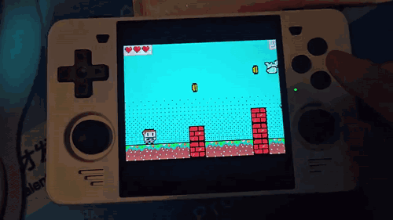
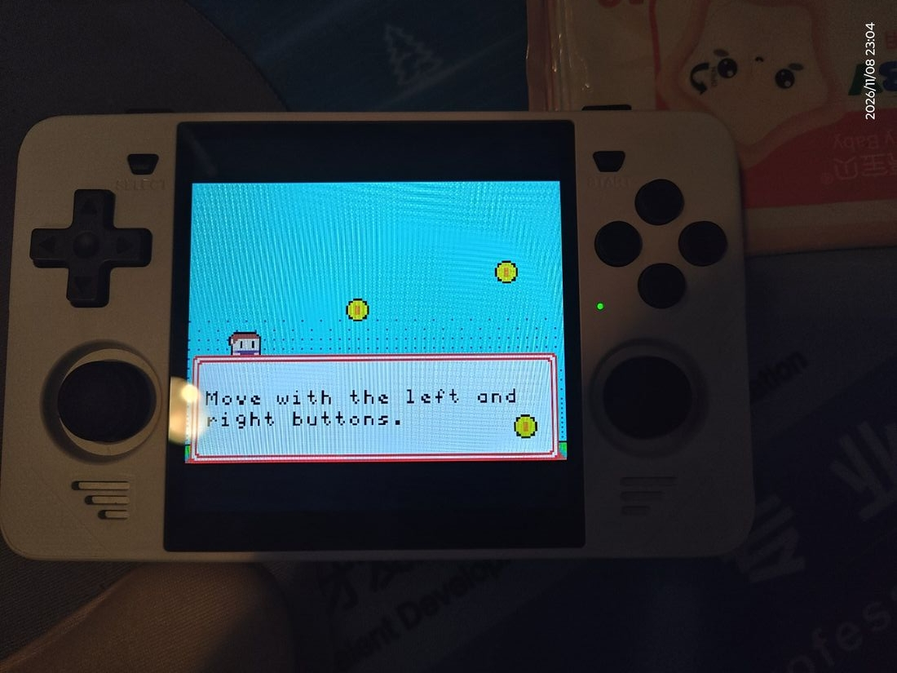
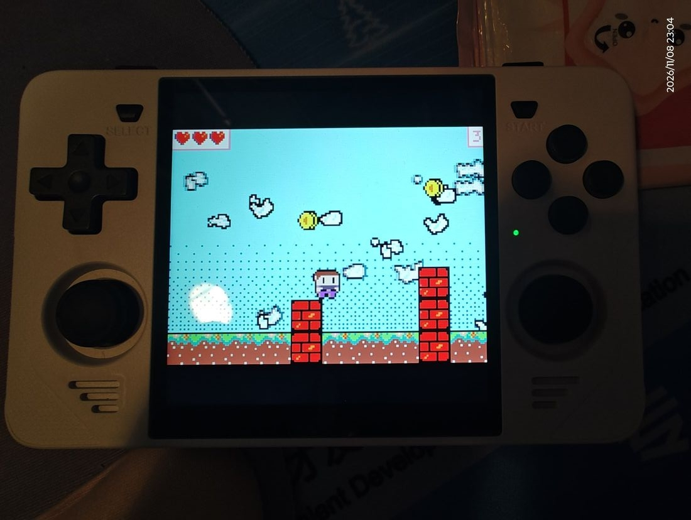

# MakeCode Arcade libretro Core (Route B)

English | [简体中文](README.md)

[](https://github.com/whmzsu/makecode-arcade-libretro/actions/workflows/build.yml)

Run MakeCode Arcade games as "cartridges" inside RetroArch. The main
technical route is the **pxt VM bytecode + C++ runtime** (Route B), targeting
PCs and low-end ARM handhelds (RK3326 / RK3566 and similar).

## Demo



*Jumpy Platformer on a Powkiddy RGB30 (RK3566) — ArkOS + RetroArch, loading a
`.pxt64` cartridge exported straight from the official IDE.*

| Jump | Coins |
|---|---|
|  |  |

## Relationship to the two existing cores

Related sibling repositories (all owned by whmzsu, all in production use):

| Repository | Engine | Positioning | Measured performance |
|---|---|---|---|
| [mcarcade-core](https://github.com/whmzsu/mcarcade-core) | QuickJS interpreting the official sim | Compatibility baseline (semantics = browser) | Desktop: 5 ms/frame on ping, 10 ms/frame on cube-land; RK3566 is ~3–4x slower, heavy games drop frames |
| [mcarcade-libretro](https://github.com/whmzsu/mcarcade-libretro) | Hermes AOT bytecode + JIT | Performance-upgrade experiment | Desktop performance close to QuickJS; aarch64 JIT gains pending real-device validation |
| This project | **pxt VM bytecode + native C++ engine** (no JS engine) | Purpose-built for low-end handhelds, Route B | ✅ Smooth on real RK3566 hardware; targets 60 fps at <15% of a single core and <16 MB resident |

All three cores share the same C infrastructure (cart.c cartridge parsing /
decompress.c LZMA / cache.c compile cache / the embedded pxtc compiler).
Route B's value is **removing the JS engine layer entirely** — the JS
simulation layer (DOM mocks, promise microtasks, GC, per-frame JS logic) is
exactly what dominates step time on weak hardware.

## Repository layout

```
makecode_arcade/
├── README.md               This file (Chinese)
├── README_EN.md            English readme
├── LICENSE                 MIT
├── .github/workflows/build.yml  GitHub Actions: all-platform build regression + test artifacts
├── .gitlab-ci.yml          For the official libretro buildbot (active on the mirrored repo)
├── docs/
│   ├── ROUTE-B-DESIGN.md   Route B overall design (architecture / data flow / milestones / risks)
│   ├── PNG-FORMAT.md       .png cartridge (steganographic packing) format spec
│   ├── M2-RUNTIME-NOTES.md pxt runtime archaeology notes (the official host's 8-function ABI)
│   ├── M3-VM-HOST.md       VM host integration, acceptance records, known limitations
│   ├── CROSS-COMPILE.md    Cross-compiling (target matrix / usage / pitfalls)
│   ├── DEVICE-TEST.md      Real-device acceptance records (RK3566 + ArkOS, incl. post-mortems)
│   └── INPUT.md            Buttons and options (mapping, descriptors, verification)
├── core/                   libretro core (C/C++)
│   ├── libretro.h          Official header (from libretro-common, MIT)
│   ├── Makefile            Standard libretro build (platform=unix/win/win64/osx/android)
│   ├── jni/                Android.mk + Application.mk (the official CI's ndk-build path)
│   ├── src/
│   │   ├── libretro_core.cpp   libretro entry points + frame loop + video/audio/input wiring
│   │   ├── vm_host.cpp         pxt VM host wrapper (image load / button edges / frame+audio pulls)
│   │   └── platform.h          pxt VM host ABI (mirrors the official sdlmain.cpp)
│   ├── tests/              Fake-frontend core_test / contract self-check contract_test / VM smoke vm_smoke
├── runtime/
│   ├── pxtapp/             Official pxt VM kernel + engine primitives (vendored, 3 patches applied, game-agnostic)
│   └── VENDORING.md
├── tools/
│   ├── build_core.sh       One-shot build: DLL + the three test programs
│   ├── make_local.sh       Drives core/Makefile through zig (when no target toolchain is installed)
│   ├── build_target.sh     Single-target cross-compile (zig; Android uses NDK clang)
│   ├── build_matrix.sh     Release matrix (5 mainstream targets) / --all for every architecture
│   ├── package_release.sh  Package release zips (core + .info + install notes)
│   ├── inspect_binary.py   Artifact self-check (arch / libc baseline / deps / retro_* exports, stdlib only)
│   ├── make_probe_cartridge.py  Probe-cartridge generator (button/lifecycle regression; uses the sibling repo's pxt toolchain)
│   ├── test_buttons.py     Button mapping regression (16 cases)
│   ├── test_lifecycle.py   Lifecycle regression (game switching / unload / audio after reset)
│   ├── libretro_host.py    Fake frontend host + descriptor static self-check (--dry)
│   ├── extract_png_meta.py Standalone .png cartridge decoder verification tool (pure Python stdlib)
│   └── make_test_cartridge.py  Synthetic test-cartridge generator (encode/decode round-trip self-test)
├── png_examples/           Real cartridge samples (ping / jumpy / cube-land / falling-duck / destroy-the-castle)
└── test_cartridge.png      Synthetic cartridge sample (self-test passes)
```

Note: the files under `docs/` are written in Chinese; file names are kept as-is
for cross-referencing.

## Milestones at a glance

| Milestone | Scope | Status |
|---|---|---|
| M0 | Core skeleton compiles, loads in RetroArch, shows a test screen | ✅ Compile-verified (zig 0.17.0) |
| M1 | .png cartridge decoding (pixel decode + blob bitstream + LZMA + project JSON) | ✅ Once wired through cart.c; 3 real cartridges smoke-pass. **The whole path was removed from the core in v0.3.5** (only `.pxt64` is accepted); PNG parsing now lives in the toolchain only (cartconv / `tools/extract_png_meta.py`) |
| M2 | Vendor the pxt C++ runtime (screen/sprite/engine), standalone build | ✅ pxtapp vendored into runtime/pxtapp (33 game-agnostic TUs; ping/jumpy/cube-land verified against one binary) |
| M3 | Hook up the pxt VM bytecode interpreter, run the first game | ✅ **All three games pass**: vm_smoke (official ABI, direct calls) + the libretro fake-frontend path (RGB565 / button edges / audio) |
| M4 | Input / audio synthesis / complete 60 fps frame model | ✅ Every host interface wired: button descriptors / per-button rebinding, audio synthesis with peak regression, frame-driven virtual clock (one frontend poll = one frame; fast-forward = the frontend polling faster), panic banner, save-directory hookup (trace/data go to `GET_SAVE_DIRECTORY`), panic self-healing — see `test_lifecycle`. **v0.3.0 scope cut: no savestates / rewind (`retro_serialize*` are stubs, the frontend auto-disables them); the core only does what the official emulator does** |
| M5 | Offline conversion tool (.png → bytecode) + game compatibility test set | ✅ Split into the standalone repo [makecode-arcade-cartconv](https://github.com/whmzsu/makecode-arcade-cartconv) (portable cartconv package + png2pxt64.py reference implementation); verified on three cartridges |
| M6 | Cross-compiling (handheld/desktop/mobile) + performance validation | ✅ **All 5 mainstream 64-bit targets build and ship as zips** (Windows x64/arm64, Linux x64/arm64, Android arm64); 32-bit targets were removed entirely (no longer built or released) — the PXT64 image cannot run on a 32-bit VM, see "64-bit frontends only" below; ✅ **RK3566 + ArkOS real-device acceptance passed** (full regression v0.2.1→v0.3.0, up to 166–361 fps); ✅ **RK3326 + ArkOS entry-level device accepted** (v0.3.0, heaviest game at 66 fps); ✅ **Android arm64 accepted** (v0.2.7) |

## Requirements and quick start

| Tool | When you need it | Notes |
|---|---|---|
| bash | Running the .sh scripts | Git Bash is enough on Windows |
| GNU make | Building via `core/Makefile` (or the official CI) | Git Bash on Windows has no make; use the `prebuilt/windows-x86_64/bin/make.exe` shipped with the NDK, or just `tools/build_core.sh` (no make required) |
| zig ≥ 0.17 | Compiling the core (the only build dependency) | `zig cc`/`zig c++` act as the compiler driver. By default it looks for `<project parent>/common tools/zig/`; override with the `ZIG` environment variable |
| Python 3 | Test and packaging scripts | stdlib only, no pip installs |
| node + npm | Converting cartridges (in the **makecode-arcade-cartconv** repo, next row) | Dependency list in its `vm-build/` (lockfile pins pxt-arcade@4.2.1 + pxt-core@13.2.1; node_modules is not committed) |
| Android NDK | Cross-compiling Android targets only | Verified with r27c. Set `ANDROID_NDK_HOME`, or place it at `<project parent>/common tools/android-ndk-r27c` |

In short: **just want to build the core and run tests** → zig is enough;
**want your own game as a `.pxt64`** → export it from the official IDE (one-time
setup, nothing to install; see "Getting a `.pxt64`"); **need to batch-convert a
pile of `.png`** → grab the
[makecode-arcade-cartconv](https://github.com/whmzsu/makecode-arcade-cartconv)
portable package; **just want to play** → download a release zip + converted
.pxt64 files, nothing to install.

## Build toolchain

`core/Makefile` is a **standard libretro Makefile** (supports `platform=`; the
official buildbot uses it to build, and the root `.gitlab-ci.yml` lists the
supported CI targets). Local cross-compile matrix uses
`tools/build_target.sh` (zig-driven, identical source set to the Makefile).

```bash
# Native build (auto-detects unix / win64 / osx)
make -C core

# Cross-compile: pass zig as the compiler driver
make -C core platform=unix  CC="zig cc -target x86_64-linux-gnu.2.17" \
                            CXX="zig c++ -target x86_64-linux-gnu.2.17"
make -C core platform=win64 CC="zig cc -target x86_64-windows-gnu" \
                            CXX="zig c++ -target x86_64-windows-gnu"
```

> If the zig path contains spaces, `make CC=...` gets split by the shell.
> `tools/make_local.sh` already handles this (generates a wrapper script and
> passes that to make):
>
> ```bash
> tools/make_local.sh            # native platform
> tools/make_local.sh win64      # Windows x64
> tools/make_local.sh linux-x64  # Linux x86_64 (glibc 2.17 baseline)
> tools/make_local.sh clean win64
> ```

Android goes through the NDK's `ndk-build` (same path as the official CI):

```bash
"$ANDROID_NDK_HOME/ndk-build" NDK_PROJECT_PATH=. \
    APP_BUILD_SCRIPT=core/jni/Android.mk \
    NDK_APPLICATION_MK=core/jni/Application.mk \
    APP_ABI=arm64-v8a NDK_OUT=out/ndk/obj NDK_LIBS_OUT=out/ndk/libs
```

`platform` values: `unix` (including `unix-*`) / `win` / `win64` / `osx` /
`android`. Object files land in `core/build/make/<platform>/` and never
pollute the source tree.

One-shot native build + the three test programs:

```bash
tools/build_core.sh   # DLL + core_test + contract_test + vm_smoke
```

### Getting a `.pxt64`: export from the official IDE (recommended) / batch-convert with cartconv

The official web IDE ships a **VM target**: enable **Experimental Hardware**
under About → Experiments, pick **VM** as the hardware, and the same Download
button produces a `.pxt64` — straight from the official compiler, nothing to
install (the toggle lives in browser storage, so it is a one-time setup).

Step-by-step, with screenshots and troubleshooting (English / Chinese):
[Exporting pxt64 from the official IDE](https://github.com/whmzsu/makecode-arcade-cartconv/blob/main/MakeCode%20Arcade%20%E5%A6%82%E4%BD%95%E5%AE%98%E6%96%B9%E5%AF%BC%E5%87%BApxt64/%E5%AE%98%E6%96%B9%E5%AF%BC%E5%87%BApxt64%E6%8C%87%E5%AF%BC.en.md)
· [简体中文](https://github.com/whmzsu/makecode-arcade-cartconv/blob/main/MakeCode%20Arcade%20%E5%A6%82%E4%BD%95%E5%AE%98%E6%96%B9%E5%AF%BC%E5%87%BApxt64/%E5%AE%98%E6%96%B9%E5%AF%BC%E5%87%BApxt64%E6%8C%87%E5%AF%BC.md)

To **batch**-convert (a whole directory of `.png` cartridges), or for offline /
unattended use, there is the converter (**cartconv**, `.png` → `.pxt64`,
Node.js; byte-identical output to the official IDE). It and the pxt compile
chain live in their own repo:
**https://github.com/whmzsu/makecode-arcade-cartconv**

- A zero-install portable package (bundled node runtime + pxt compile chain,
  ~85 MB) is on its Releases; unzip and drag a `.png` onto `cartconv.exe`
  (single file / multi-select / whole directory).
- On non-Windows, run from source: `node cartconv.js game.png`
  (`npm install` inside the repo first).
- ~10 s per cartridge. Covers scope, pre-flight rejection (community
  extensions / binary assets / versions); implementation details and pitfalls
  in that repo's README.

This repo keeps `tools/extract_png_meta.py` (a pure-Python reference
implementation of .png cartridge parsing) for testing; the probe/test
cartridge generators (`make_probe_cartridge.py` etc.) automatically find the
pxt toolchain in the sibling directory `../makecode_arcade_cartconv`.

### Cross-compiling and releases

Pure C/C++ with no platform-specific dependencies; zig bundles the libc
headers, so switching `-target` is all it takes:

```bash
tools/build_matrix.sh     # Release matrix: 5 mainstream targets (all 64-bit, ~30 s)
tools/package_release.sh  # Package into zips ready to drop into RetroArch
```

| Platform | Artifact |
|---|---|
| Windows x64 / ARM64 | `makecode_arcade_windows-x64.zip` / `-arm64.zip` |
| Linux x64 / ARM64 | `makecode_arcade_linux-x64.zip` / `-arm64.zip` |
| Android ARM64 | `makecode_arcade_android-arm64.zip` |
| Lakka / LibreELEC ARM64 (musl) | `makecode_arcade_lakka-arm64.zip` |
| Nintendo Switch (NX) | `makecode_arcade_switch.zip` (NRO + `.info`) |

> **64-bit frontends only** (important). Cartridges contain a **PXT64**
> bytecode image: the official pxt compiler (the arcade target of
> `pxt-core`) **has no switch that emits 32-bit images**. Its only hook for
> adapting to 32-bit targets is patching the image in place to the native
> layout, and that function (`vm_patch_image` in
> `runtime/pxtapp/core---vm/verify.cpp`) still has the upstream
> `return "TODO: NumberBoxes"` in its `PXT32` branch — never implemented,
> and callers don't check the return value either. So the image loads as-is →
> boxed numbers get garbage vtables → validation fails with 1064 → the VM
> thread exits within milliseconds.
>
> Real-device testing (one RK3566 and one RK3326, `retroarch32` + armhf
> core): the frontend lists the core, loading works, the log even prints
> `VM started`, but the **VM thread exits after 3 ms**
> (trace `vm ready (online=0 live=0)`) and the screen stays black.
>
> Therefore **the core no longer supports or builds 32-bit targets**:
> armhf / armeabi-v7a / i686 etc. are removed from the release matrix,
> GitHub Actions, and the buildbot list; there are no 32-bit CI jobs, and
> `core/jni/Application.mk` lists only `arm64-v8a`. We don't even do a
> compile check for 32-bit — until upstream fixes that TODO, anything built
> is guaranteed not to run, and keeping it is just noise.
>
> Fixing that upstream hole is out of scope for this project: converting
> PXT64 → 32-bit native layout is the compiler's job, and hard-patching it on
> the core side would mean inventing a private ABI for near-zero benefit —
> both real devices run fine with 64-bit frontends.

### Lakka / LibreELEC (musl)

Lakka uses **musl libc**, which cannot load our glibc dynamic `.so`. The Lakka
build is therefore a **zero-dependency fully static DSO** (no `NEEDED` entries
in `readelf -d`, loadable on any Linux).

The musl target deliberately avoids local zig: zig 0.17's musl can only produce
either a dynamic library that needs the system `libc.so` (absent from the Lakka
rootfs) or an exe-only non-PIC static library whose data symbols use ABS64
relocations that fail to link into a shared object. CI builds it with the
dockcross aarch64-musl image plus GNU ld `-shared -static` - the same scheme
libretro buildbot uses for Lakka cores:

```bash
# Equivalent to the lakka-musl job in .github/workflows/build.yml
docker run --rm -v "$PWD":/work -w /work \
  dockcross/linux-arm64-musl:latest bash tools/build_musl.sh
```

Install: drop `makecode_arcade_libretro.so` and `makecode_arcade_libretro.info`
into `/storage/cores/` on Lakka (SSH defaults to root/lakka) and refresh the
core list. A 900-frame miniretro smoke run covers it in CI
(`behavior-miniretro (musl 全静态)`).

### Nintendo Switch (RetroArch NX)

The Switch has **no `dlopen`**, so a core cannot be dropped in as a `.so`. Here
the build product is a **static archive** (`makecode_arcade_libretro_libnx.a`,
built with devkitA64, `-fPIE`) that RetroArch's `Makefile.libnx` links together
with the frontend into a NRO - **one NRO carries exactly one core**, which is
also the shape of the cores the official online updater distributes.
`tools/package_release.sh` does not take part; a dedicated workflow handles it.
Its output is also not part of the 6-platform release matrix — it gets **its own
release on `nx-v*` tags** (version kept in sync with `core-v*`, e.g.
`nx-v0.3.3` ↔ `core-v0.3.3`):

```bash
# equivalent to .github/workflows/nx.yml (inside devkitpro/devkita64)
make -C core platform=libnx                  # -> core/makecode_arcade_libretro_libnx.a
cp core/makecode_arcade_libretro_libnx.a /path/to/RetroArch/libretro_libnx.a
cd /path/to/RetroArch && make -f Makefile.libnx   # -> retroarch_switch.nro
```

Install: copy `makecode_arcade_libretro_libnx.nro` (and optionally the
`.info`) into **`sdmc:/switch/`** - the NRO is a standalone homebrew program
(frontend + core linked together), and hbmenu only scans that directory; it is
NOT a core for `sdmc:/retroarch/cores/`. Cartridges go anywhere (e.g.
`sdmc:/roms/makecode/`). Start it via title takeover (hold R while launching
any game to reach hbmenu) for full memory.

> **Known issue (real-device tested 2026-11, firmware 21/22 + Atmosphere
> 1.11~1.12)**: the RetroArch frontend crashes when **loading any core** in
> title takeover mode - crash reports land in mesa/nouveau's nv50_ir shader
> compiler reading wild pointers; stock RetroArch 1.21.0/1.22.2 without any
> third-party core crashes the same way, so this is unrelated to our core.
> Upstream: [libretro/RetroArch#18905](https://github.com/libretro/RetroArch/issues/18905)
> (open). In applet mode the NRO runs inside hbloader, and launching RA 1.21.0
> there crashes the whole hbloader process (console reboot). Firmware 20 and
> below are unaffected; until upstream fixes it, fw21/22 users need a firmware
> downgrade or another device.

> Archiver trap: GNU `ar` stores basenames only, and `runtime/pxtapp` has both
> `base/control.cpp` and `core---vm/control.cpp` - archiving directly lets the
> later member silently overwrite the earlier one, surfacing as missing symbols
> at link time. The Makefile copies objects to flattened unique names and
> asserts member count == object count.

Each zip contains the core binary + `.info` + install notes. Linux targets
are pinned to a glibc 2.17 baseline (covers handheld firmware from 2012
onward); Android statically links libc++ and is 16 KB-page aligned
(Android 15).

> **Android install notes**: unzip the zip first — the "Install or restore
> core" file browser filters by platform extension and on Android lists only
> `.so` files (**zips don't appear**); picking the unzipped `.so` copies it
> into the cores directory. The `.info` is not carried over; put it in the
> **core info directory** (`libretro_info_path`, defaults to the cores
> directory) yourself. The cores directory must stay in the app's private
> storage — since Android 10, `/storage/emulated/0` is noexec, so a core
> there is detected but always fails to load. Full steps in round 5 of
> `docs/DEVICE-TEST.md`.

```bash
tools/build_matrix.sh --all                    # Full-matrix validation (all 20 64-bit targets pass)
tools/build_matrix.sh --prune                  # Back to the 5 release targets, removing other targets' dist/build dirs
python tools/inspect_binary.py                 # Arch + libc baseline + deps + retro_* exports
```

Artifacts land in `core/dist/<triple>/`, summary table in
`core/dist/MATRIX.md`. The workspace keeps only the 5 release targets by
default (run `--prune` after an `--all` validation; the zips in
`dist/release/` are untouched). Details and pitfalls (glibc baseline, Android
NDK, big-endian byte order) in **docs/CROSS-COMPILE.md**.

The pxt toolchain (needed by this repo's probe/test cartridge generators):
node + npm. Dependency list and install instructions live in the sibling
repo **makecode-arcade-cartconv** under `vm-build/`:

```bash
cd ../makecode_arcade_cartconv/vm-build && npm install
```

## Continuous integration (GitHub Actions)

`.github/workflows/build.yml` builds every platform on each push / PR. Its
purpose is to **catch "source that doesn't compile" commits** and attach
runnable artifacts as workflow artifacts (kept 30 days, download from the
bottom of the Actions run page).

| Matrix | Toolchain | Artifact |
|---|---|---|
| `linux-x64` / `linux-arm64` | Ubuntu 22.04 + gcc cross packages | `.so` |
| `windows-x64` | mingw-w64 (**-posix** threading model; the pxt VM uses pthreads) | `.dll` |
| `android-arm64` | Runner-provided NDK + `core/jni/` (same parameters as the official template) | `.so` |
| `zig-*` (x64/arm64 Windows + Linux x64/arm64) | **Same toolchain as local releases** (zig 0.17.0 + `tools/build_target.sh`) | `.so` / `.dll` |
| `macos-universal` | Xcode clang, arm64+x86_64 | `.dylib` (experimental, `continue-on-error`) |
| `lakka-musl` | dockcross `linux-arm64-musl` + GNU ld `-shared -static` | `.so` (**fully static, zero `NEEDED`**, for musl systems like Lakka/LibreELEC) |
| `behavior-miniretro` | real aarch64 runner (`ubuntu-24.04-arm`) + third-party frontend miniretro | 900-frame smoke run (behaviour layer, not compile layer) |
| `package` | Collects distro-toolchain artifacts → `tools/package_release.sh` | 5 zips |
| `release` (only on `core-v*` tags) | Collects `zig-*` + `android-*` + `lakka-musl` artifacts → `package_release.sh` → `gh release create` | **6 zips** (including `windows-arm64`, which only zig can produce, and `lakka-arm64`, which only the musl toolchain can produce) |

NX (Switch) is not in this table: it is handled by a separate
`.github/workflows/nx.yml` that **creates its own release on `nx-v*` tags**.
It is kept apart from core releases because the NRO needs the RetroArch
sources plus a pile of portlibs (a dozen-plus minutes), which would slow down
every core release if chained into the main pipeline. The artifact shape
differs too — an NRO embeds the frontend itself, it is not a `.so` you can
drop into `cores/`.

The toolchains are **deliberately split in two** — don't merge them:

- The distro toolchains (gcc / mingw / NDK) prove "the source compiles under
  the official buildbot's configurations". Toolchain differences are
  regression value in themselves — the `GetTickCount64` compile failure
  (mingw-gcc defaulting `_WIN32_WINNT` to XP) was caught by exactly this
  class of job on its first run; zig's headers default high enough that
  switching everything to zig would hide such issues.
- The `zig-*` jobs use the same zig version and the same script as the local
  release matrix, proving the release configuration reproduces on CI, and
  they cover two things the distro toolchains can't: **windows-arm64** and
  the **glibc 2.17 baseline hard assertion** (`readelf -V` max symbol
  version ≤ 2.17, red if exceeded). Android is already built locally with
  NDK clang — same toolchain as the android job, no need to duplicate.

Every job carries assertions, not just "it compiled":

- Linux: `readelf -d` `NEEDED` may only contain libc/libm/libdl/libpthread/
  librt/libstdc++/libgcc_s (anything else means the linking went sideways),
  and GLIBC symbol versions are printed
- Windows: the import table must not contain `libstdc++-6.dll` /
  `libgcc_s_*.dll` / `libwinpthread-1.dll` (players usually don't have these
  DLLs), and `retro_init` / `retro_run` exports must exist (checks that
  `--export-all-symbols` took effect)
- Android: must not depend on `libc++_shared.so`; `LOAD` segments must be
  0x4000-aligned (16 KB-page devices)

Division of labor between the two CI files, don't mix them up:

| File | Runs on | Purpose |
|---|---|---|
| `.github/workflows/build.yml` | This repo (GitHub-hosted runners) | Compile regression + test artifacts |
| `.gitlab-ci.yml` | The official libretro buildbot (mirrored repo) | For inclusion in the RetroArch Core Downloader |

**Releases are tag-triggered.** Pushing a `core-v*` tag makes the `release`
job wait for `zig-*` and `android-*`, package 5 zips (64-bit only) with the
same local `tools/package_release.sh`, then create the GitHub Release and
attach the zips.

- Credentials use the repo's built-in `GITHUB_TOKEN` (job-level
  `contents: write`; globally still read-only). **No PAT needed.** Release
  objects and asset uploads only exist over the HTTPS API — git/SSH can't
  reach that layer; the SSH key only pushes commits and tags.
- Hard assertions before release: exactly 6 packages, every package's `.info`
  `display_version` must equal the tag — one short or mismatched version
  turns the job red, so a partial release can't ship.
- Release notes come from `.github/release-notes/<tag>.md`; falls back to
  `--generate-notes` if missing.
- Re-run safe: if the Release exists, it goes through `upload --clobber` +
  `edit` without erroring.

Real-device acceptance (R1) can only happen on the devices themselves and
cannot be automated. Tag-built packages and local `tools/build_matrix.sh`
share the toolchain and the 2.17 baseline, but different build environments
may produce byte differences.

Manual trigger: repo Actions page → build → Run workflow.

## Testing (no RetroArch needed)

```bash
tools/build_core.sh

# 1) Cartridge → bytecode (offline; needs the node toolchain, see "Requirements")
python tools/png2pxt64.py png_examples/arcade-ping.png out/ping.pxt64

# 2) Fake frontend runs the full libretro path on a .pxt64 (60 fps cadence, BMP output)
#    Saves and mca_trace.log land in out/core_test_data/ by default (--data-dir=DIR to change);
#    no files are created in the project root
core/core_test.exe out/ping.pxt64 out/ping.bmp 120 --press=LEFT --every=40

# 3) Contract self-check (no cartridge needed: system_info / environment ordering /
#    terminators of the three arrays / non-.pxt64 must fail to load)
core/contract_test.exe
#    CI runs the same assertions once more under UBSan: make -C core platform=unix SANITIZE=undefined contract-test

# 4) Button mapping regression (probe cartridge + color assertions, 16 cases)
python tools/make_probe_cartridge.py                # generates out/pxt64/probe.pxt64
python tools/test_buttons.py

# 5) Lifecycle regression (three game switches / dlclose after close / audio recovery after reset)
python tools/make_probe_cartridge.py --audio        # generates out/pxt64/audio_probe.pxt64
python tools/test_lifecycle.py

# 6) Independent frontend cross smoke (also in CI): miniretro loads the core and runs 900 frames
#    (see the behavior-miniretro job in .github/workflows/build.yml)
```

### Three "flashlights" (not regression tests)

| Tool | What it looks at | Time |
|---|---|---|
| `tools/retroarch_smoke.sh` | **Real frontend**: dlopen, `.info` parsing, pixel-format negotiation, SAVE_DIRECTORY, screenshot, teardown | ~20 s for 3 carts |
| `tools/fuzz_pxt.sh` | OOB reads / UB in the pxt64 parse+verify layer (clang libFuzzer + ASAN) | 150–300 s per round |
| `tools/coverage.sh` | Which lines never execute (`-O0 --coverage` + gcovr, HTML report) | ~2 min |

```bash
xvfb-run -a tools/retroarch_smoke.sh              # headless; skip xvfb-run if you have X
tools/fuzz_pxt.sh -max_total_time=300             # crash samples land in out/fuzz/crash-*
tools/coverage.sh --corpus /path/to/carts         # report in out/coverage/
```

These do not "remember a result" — they surface problems. `retroarch_smoke.sh` found
"exit 139 on quit" (pxt static destructors + dlclose, fixed with `DF_1_NODELETE`) on its
very first run, and `fuzz_pxt.sh` found the section-table OOB read (PATCH 12) in its first
round. Running them occasionally beats meeting the same bugs on a handheld.

Verified: ping / jumpy / cube-land all run as VM bytecode and render
correctly on **the same prebuilt core binary** (the vendored pxtapp C++ tree
is game-agnostic; functions.json is byte-identical).

## Using with RetroArch

> **The core only runs `.pxt64` bytecode, and the file browser only lists
> `.pxt64`.** A `.png` cartridge contains only **source code** (meta +
> source), not a runnable game — get a `.pxt64` either by exporting it from the
> official IDE (recommended, nothing to install; see "Getting a `.pxt64`"
> above) or by batch-converting with
> [cartconv](https://github.com/whmzsu/makecode-arcade-cartconv).
> The core does not accept `.png` as load content.

1. Take `core/dist/release/makecode_arcade_<platform>.zip`, **unzip it
   first**, put the core binary into RetroArch's "cores" directory and
   `makecode_arcade_libretro.info` into the "core info" directory (simplest;
   both may also be configured to the same directory). **The actual locations
   vary by platform/distro** — check your device's real paths under RetroArch
   `Settings → Directory → Cores / Core Info`. You can also use "Install or
   restore core" and pick the unzipped binary, but that file browser only
   lists the **core file extensions for the current platform** (Windows
   `.dll` / Linux `.so` / macOS `.dylib`), **zips never appear in the list**,
   and the `.info` is not carried over;
2. Load Content → pick a converted `.pxt64` file;
3. Pixel format RGB565, 160x120, 60 fps target, 44.1 kHz mono audio.
   Reset / restart / switching games:
   - The Reset button (default SELECT, rebindable in Controls) or the
     frontend's "Restart" = restart the current game; VM state is fully
     reset and **both video and audio recover**;
   - "Close Content" / loading a different cartridge genuinely stops the VM
     thread (joined in `retro_unload_game` / `retro_deinit`) — no more
     "closing a game crashes RetroArch";
   - Every reset writes a trace to `mca_trace.log` in the save directory
     (falls back to the current directory / `/tmp` if unwritable; the actual
     path is printed in the RetroArch log line
     `[MCA] core version ... trace -> ...`), so a hang shows exactly which
     step it stalled on.

## Scope boundaries and the panic banner

- **Fast-forward / slow-motion**: the core does nothing. The virtual clock is
  **frame-driven** (each frame the frontend pulls advances the VM by 1/60 s
  of virtual time), so RetroArch's fast-forward (higher retro_run rate)
  naturally speeds the game up, slow-motion (lower poll rate) slows it down,
  and the pull-based audio follows. Scaling the clock step is a non-starter
  (it makes forever loops drop ticks).
- **Savestates / Rewind: not supported by this core** (explicitly removed as
  of v0.3.0; the scope is "feature parity with the official emulator").
  `retro_serialize_size` is always 0, so RetroArch auto-disables savestates,
  rewind, and run-ahead; the core takes no snapshots, and therefore carries
  none of that fixed-address / pause-handshake / fingerprint-checking
  complexity.
- **Panic made visible**: when the VM panics, a white-on-red
  `VM PANIC <code>` banner appears at the top of the screen and disappears
  automatically once the restart succeeds; details are still mirrored to the
  RetroArch log (`[MCA-VM] panic code N`), so on a handheld you can match
  the fault code without digging through logs.
- **A panic no longer takes down the frontend** (v0.3.2): after a panic the
  VM thread bounces back to the main loop for a full cleanup and exit, and
  the frontend auto-restarts (up to 3 times; if it still fails, it stops and
  shows the banner) — the RetroArch process always survives. Panics are
  usually the game's own bug (e.g. using undefined as an array); historically
  such cartridges could crash the whole frontend (Windows 0xC0000005), and
  one JS try/catch exception-unwind path crashed on mingw
  (STATUS_BAD_STACK) — both fixed.

## Buttons

Default mapping (RetroPad → MakeCode):

| RetroPad | MakeCode | Notes |
|---|---|---|
| A | A | Jump / OK |
| B | B | Back / Cancel |
| D-pad ↑↓←→ | Direction | |
| START | Game Menu | The in-game menu (the small menu key on real hardware) |
| SELECT | Reset | The small reset key on real hardware; press once to restart the game |

**The core ships zero core options** (Quick Menu → Options is empty). All
button adjustments happen under Quick Menu → Controls, a page populated by
the core's `SET_INPUT_DESCRIPTORS` with 8 semantic labels
(`A -> MakeCode A (jump / OK)`,
`Start -> Game Menu (in-game menu key)`,
`Select -> Reset (restart game)`, etc.):

- Handhelds often swap A/B relative to MakeCode → bind "MakeCode A" to the
  physical B button and vice versa
- Want a different key for the game menu / restarting → rebind that
  descriptor to another physical button

> Don't confuse: `Start -> Game Menu` is the **game's own** menu; RetroArch
> separately has the `Menu Toggle` hotkey (opens the frontend Quick Menu).
> If they collide, change or clear `Menu Toggle` under
> Settings → Input → Hotkey Binds.

Automated regression:

- `python tools/test_buttons.py` — buttons. A probe cartridge paints each key
  press as a fixed background color; the last frame is captured and the
  color asserted. 16 cases cover the 8 mappings, no false triggers from
  unmapped keys, the bitmask fast path, and "buttons still register after a
  reset" as proof of restart liveness (a white background alone can't
  distinguish a successful reset from a frozen screen).
- `python tools/test_lifecycle.py` — lifecycle. Three consecutive game
  switches (unload → load → …), no crash when the core library is
  `dlclose`d after closing a game, and after a reset the audio sample peak
  must go above 0 again (using the sound probe cartridge from
  `make_probe_cartridge.py --audio`), plus a descriptor self-check.
- `libretro_host.py --dry` — descriptor static self-check (exactly one
  Game Menu and one Reset entry, no duplicated keys, no core options).

Design notes (including reset, unload, and post-restart audio) in
`docs/INPUT.md`.

See docs/ROUTE-B-DESIGN.md for the full design.

## License

This project is released under the [MIT](LICENSE) license. Vendored
components keep their original licenses: `core/libretro.h` and
`runtime/pxtapp/` (the Microsoft pxt runtime) are MIT — sources and
provenance in `runtime/VENDORING.md`. (The miniz / LzmaDec copies under
`core/third_party/` were only used for PNG decoding and were removed together
with that path in v0.3.5.) The cartridge converter and its pxt
toolchain live in the
[makecode-arcade-cartconv](https://github.com/whmzsu/makecode-arcade-cartconv)
repo; pxt dependencies come via `npm install` and are likewise Microsoft MIT.
